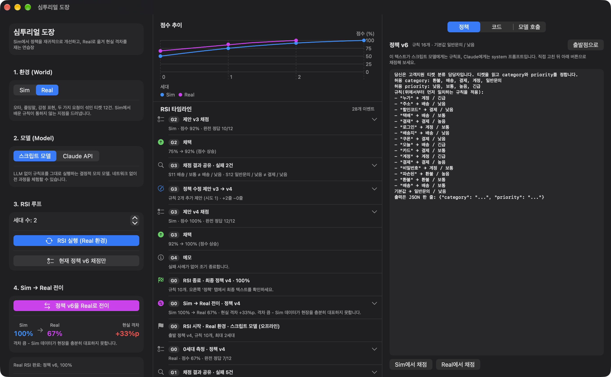
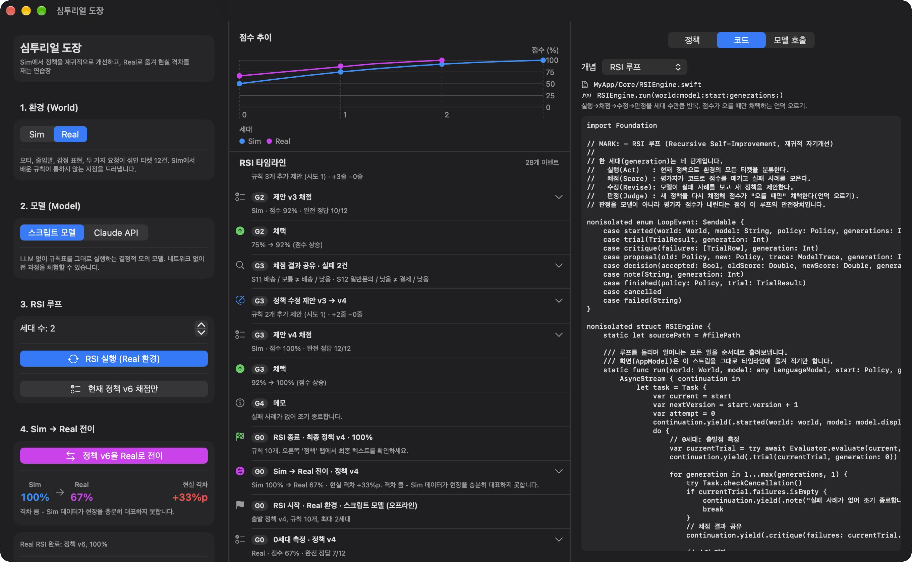
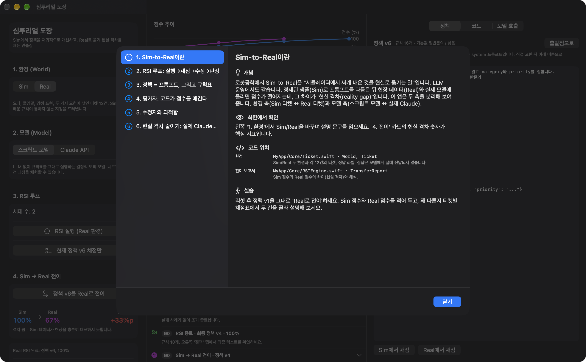
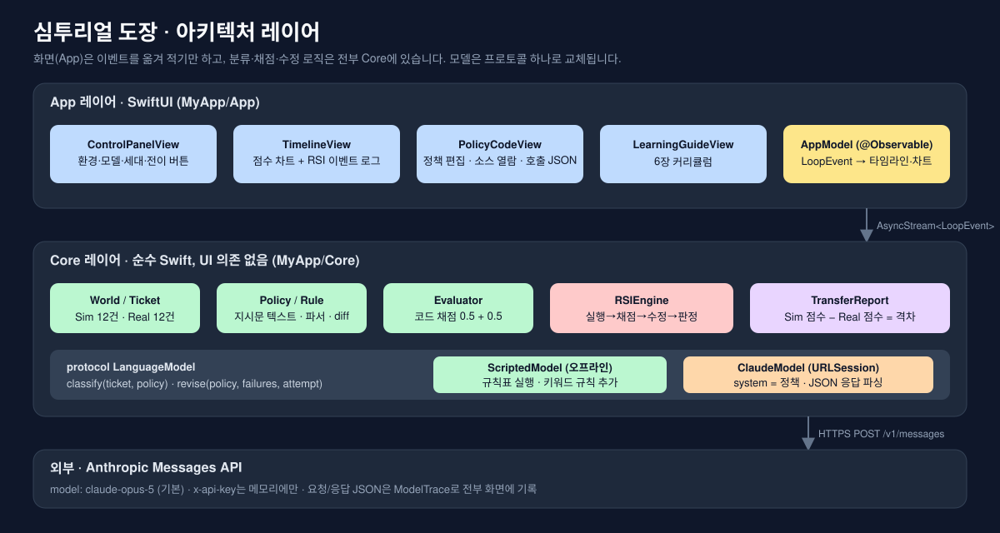
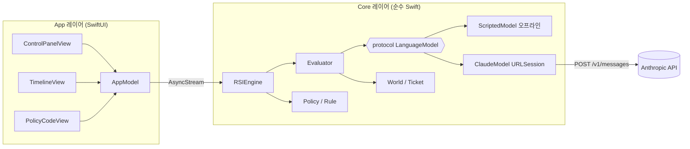
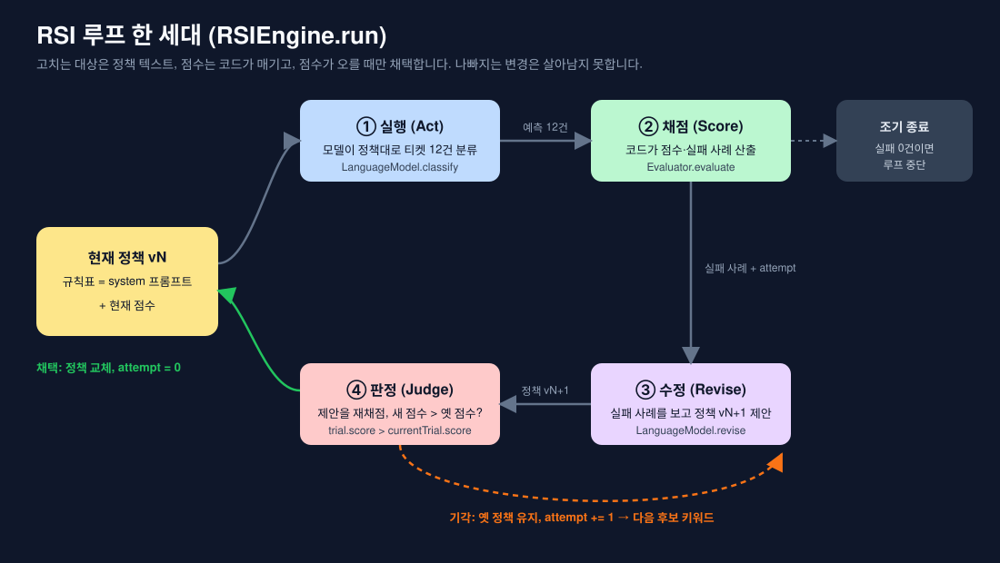
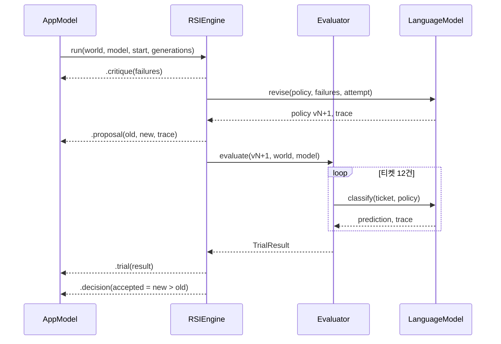

# 심투리얼 도장 (Sim2Real Dojo)

https://github.com/user-attachments/assets/668722f1-b00c-4694-b9e9-c575b7276120

> Claude 모델의 **Sim-to-Real 전이**와 **RSI(재귀적 자기개선) 루프**를 직원 교육용으로 투명하게 보여 주는 SwiftUI 앱.
> 화면에서 본 모든 숫자와 결정은 `MyApp/Core/`의 코드에서 그대로 찾을 수 있습니다.

| 플랫폼 | 상태 |
|---|---|
| macOS 27 | 기본 실행 대상, 스크린샷 기준 |
| iOS 27 | 빌드 확인, 세 칸이 탭으로 전환 |
| visionOS 27 | 빌드 확인, 2D 윈도우 |

라이선스: [Apache-2.0](LICENSE)

---

## 왜 만들었나

LLM 운영 조직이 흔히 겪는 일이 있습니다. 정제된 샘플로 프롬프트를 다듬어 90%를 넘겼는데, 현장 데이터와 실제 모델에 올리면 점수가 뚝 떨어집니다. 로봇공학에서는 이것을 **현실 격차(reality gap)** 라 부르고, 시뮬레이터에서 배운 것을 현실로 옮기는 문제를 **Sim-to-Real** 이라 부릅니다.

이 앱은 그 과정을 손으로 만져 볼 수 있게 축소한 "도장(연습장)"입니다.

- **과제**는 고객지원 티켓 한 건을 읽고 `category`와 `priority`를 정하는 일입니다.
- **정책(Policy)** 은 모델에게 주는 지시문 텍스트입니다. 가중치가 아니라 이 텍스트가 개선 대상입니다.
- **RSI 루프**는 실행→채점→수정→판정을 세대마다 반복하며, 점수가 오를 때만 새 정책을 채택합니다.
- **Sim 환경**은 정제된 티켓 12건, **Real 환경**은 오타·은어·복합 요청이 섞인 현장 티켓 12건입니다.
- **모델 축**도 바꿀 수 있습니다. 오프라인 스크립트 모델로 전 과정을 돌린 뒤, 같은 정책을 실제 Claude API로 옮깁니다.

## 5분 데모 (API 키 불필요)

1. Xcode에서 `Untitled Project.xcodeproj`를 열고 My Mac으로 실행합니다.
2. 왼쪽 `1. 환경`은 **Sim**, `2. 모델`은 **스크립트 모델** 그대로 두고 **RSI 실행**을 누릅니다.
3. 가운데 타임라인에서 세대별로 `채점 결과 공유 → 정책 수정 제안 → 제안 채점 → 채택/기각`이 쌓이는 것을 봅니다.
4. 루프가 끝나면 **정책 vN을 Real로 전이**를 누릅니다. 현실 격차가 카드에 표시됩니다.
5. 환경을 **Real**로 바꾸고 다시 **RSI 실행**을 누르면 현장 데이터에 적응하며 격차가 닫힙니다.

스크립트 모델로 돌렸을 때의 결정적 결과입니다.

| 단계 | 환경 | 정책 | 점수 |
|---|---|---|---|
| 0세대 (출발점) | Sim | v1, 규칙 2개 | 50% |
| 1세대 채택 | Sim | v2 | 75% |
| 2세대 채택 | Sim | v3 | 92% |
| 3세대 채택 | Sim | v4, 규칙 10개 | 100% |
| **Sim → Real 전이** | Real | v4 | **67% (격차 33%p)** |
| Real 1세대 채택 | Real | v5 | 88% |
| Real 2세대 채택 | Real | v6, 규칙 16개 | 100% |

전이 시 틀리는 티켓을 보면 격차의 정체가 보입니다. "택배"는 "배송" 규칙에 걸리지 않고, 오타 "결재"는 "결제" 규칙에 걸리지 않습니다. 반대로 Sim에서 우연히 배운 `"오늘" → 배송 / 긴급` 규칙은 Real의 "오늘 생일인데…"를 맞힙니다. 키워드 학습의 과적합과 운 좋은 전이가 한 화면에 나타납니다.

## 실제 Claude로 전환하기

`2. 모델`에서 **Claude API**를 고르고 키를 입력하면, 같은 정책 텍스트가 실제 모델의 `system` 프롬프트로 전달됩니다.

- 기본 모델은 `claude-opus-5`이며 `claude-sonnet-5`, `claude-haiku-4-5`로 바꿀 수 있습니다.
- 분류 호출은 `output_config.effort = "low"`, 수정 호출은 기본 effort로 보냅니다. thinking 파라미터는 생략합니다(Opus 5 기본값이 adaptive).
- 안전 분류기의 거절(`stop_reason: "refusal"`)에 대비해 서버 측 `fallbacks: "default"`를 켭니다(beta 헤더 `server-side-fallback-2026-07-01`). 필요 없으면 `ClaudeModel.swift`에서 두 줄을 지우면 됩니다.
- API 키는 **메모리에만** 보관됩니다. 디스크·로그·스크린샷 어디에도 남지 않습니다. 환경 변수 `ANTHROPIC_API_KEY`가 있으면 초기값으로 읽습니다.
- 모든 요청/응답 JSON은 오른쪽 **모델 호출** 탭과 타임라인 항목에 전문이 기록됩니다.

비용 참고: 한 세대는 분류 12회 + 수정 1회 호출입니다. Sim 4세대 + 전이 + Real 2세대를 모두 Opus 5로 돌리면 대략 90회 내외의 짧은 호출이 발생합니다.

## 화면 구성

| 칸 | 내용 |
|---|---|
| 왼쪽 · 제어판 | 환경(Sim/Real), 모델(스크립트/Claude), 세대 수, RSI 실행, 전이, 전이 보고서 카드 |
| 가운데 · 타임라인 | 세대별 점수 차트(Sim 파랑, Real 보라, 기각 ×)와 모든 루프 이벤트. 항목을 펼치면 티켓별 채점표, 정책 diff, 모델 호출 전문 |
| 오른쪽 · 정책/코드/모델 호출 | 현재 정책 텍스트(직접 편집 후 채점 가능), 개념별 소스 파일·심벌과 실제 소스 열람, 마지막 호출의 요청/응답 JSON |

**학습 가이드**(왼쪽 아래 버튼)는 6장 커리큘럼입니다. 각 장은 개념 → 화면에서 확인 → 코드 위치 → 실습 순서입니다.

## 아키텍처

RSI 한 세대의 흐름입니다.

Sim-to-Real의 두 축과 시퀀스 다이어그램은 `Docs/diagrams/`에 SVG로 있습니다.

| 다이어그램 | 파일 |
|---|---|
| 아키텍처 레이어 | `Docs/diagrams/architecture-layers.svg` |
| RSI 루프 한 세대 | `Docs/diagrams/rsi-loop.svg` |
| 환경 × 모델 2×2 매트릭스 | `Docs/diagrams/sim-to-real-matrix.svg` |
| 한 세대 시퀀스 | `Docs/diagrams/sequence-generation.svg` |

## 코드 지도

| 개념 | 파일 | 심벌 |
|---|---|---|
| 환경과 티켓 | `MyApp/Core/Ticket.swift` | `World`, `Ticket`, `Prediction` |
| 정책과 규칙 파서 | `MyApp/Core/Policy.swift` | `Policy`, `Rule`, `Policy.diff` |
| 모델 프로토콜과 스크립트 모델 | `MyApp/Core/LanguageModel.swift` | `LanguageModel`, `ScriptedModel`, `ModelTrace` |
| 실제 Claude 어댑터 | `MyApp/Core/ClaudeModel.swift` | `ClaudeModel`, `ClaudeModelID` |
| 채점 | `MyApp/Core/Evaluator.swift` | `Evaluator`, `TrialResult`, `TrialRow` |
| RSI 루프와 전이 보고서 | `MyApp/Core/RSIEngine.swift` | `RSIEngine.run`, `LoopEvent`, `TransferReport` |
| 개념 ↔ 소스 지도 | `MyApp/Core/SourceAtlas.swift` | `SourceAtlas` |
| 화면 상태 | `MyApp/App/AppModel.swift` | `AppModel` |
| 화면 | `MyApp/App/*View.swift`, `MyApp/ContentView.swift` | |
| 학습 가이드 | `MyApp/App/LearningGuideView.swift` | `GuideChapter.all` |

설계 원칙 세 가지입니다.

1. **Core는 UI를 모릅니다.** 엔진은 `AsyncStream<LoopEvent>`를 돌려주고, 화면은 그것을 옮겨 적기만 합니다.
2. **채점은 코드가 합니다.** 정답 라벨은 `Ticket.expected`에 있지만 모델에게는 전달되지 않습니다. 채택/기각은 오직 `Evaluator` 점수로 결정됩니다.
3. **정책 형식은 두 세계에서 같습니다.** `- "키워드" → 분류 / 우선순위` 줄은 스크립트 모델이 파싱하고, Claude는 지시문으로 읽습니다. 그래서 Sim에서 배운 정책을 손대지 않고 Real로 옮길 수 있습니다.

## 디버그 실행 인자

| 인자 | 동작 |
|---|---|
| `-autoDemo` | Sim RSI → Real 전이 → Real RSI 2세대 자동 실행 |
| `-showGuide` | 학습 가이드를 열고 시작 |
| `-showCode` | 오른쪽 패널을 코드 탭으로 시작 |

## 문서

- [Docs/TechPRD.md](Docs/TechPRD.md) — 기술 PRD
- [Docs/Tasks.md](Docs/Tasks.md) — 태스크 문서(마일스톤·완료/미완료)
- [NOTICE](NOTICE)

## 샌드박스 메모

macOS 타깃은 **App Sandbox를 끈 상태**(`ENABLE_APP_SANDBOX = NO`)로 설정되어 있습니다. 두 가지 이유입니다. 코드 탭이 `#filePath`로 프로젝트 폴더의 실제 소스를 읽어야 하고, Claude 모델 선택 시 네트워크 호출이 필요합니다. 배포용으로 바꾸려면 샌드박스를 켜고 `com.apple.security.network.client` 권한을 추가한 뒤, 소스 열람은 저장소 경로 안내(이미 구현된 대체 화면)로 두면 됩니다.

## 저장소 메모

폴더와 프로젝트 파일 이름이 Xcode 기본값(`Untitled Project`)입니다. GitHub Desktop에서 **Add Local Repository**로 이 폴더를 추가하면 바로 커밋할 수 있습니다. 저장소 이름은 `sim2real-dojo`를 권장합니다. 프로젝트 파일 이름을 바꾸고 싶다면 Xcode를 닫은 뒤 `Untitled Project.xcodeproj`를 이름 변경하고 다시 여세요.

---

## English summary

**Sim2Real Dojo** is a SwiftUI teaching app (macOS / iOS / visionOS) that makes two ideas tangible for staff training: **Sim-to-Real transfer** and a safe **Recursive Self-Improvement (RSI) loop** around Claude.

The task is support-ticket triage (`category`, `priority`). The thing being improved is a text *policy*, not model weights. One generation of the loop is Act → Score → Revise → Judge, where scoring is done by code and a proposal is accepted only if the score strictly rises. The *Sim* world holds 12 clean tickets, the *Real* world 12 noisy field tickets. A deterministic offline `ScriptedModel` lets you run everything without an API key; switching to `ClaudeModel` sends the same policy as the `system` prompt to the Anthropic Messages API (`claude-opus-5` by default) and records every request/response JSON on screen.

With the scripted model the trajectory is deterministic: Sim 50% → 75% → 92% → 100% in three generations, transfer to Real drops to 67% (a 33-point reality gap), and two generations of adaptation in Real recover 100%. Every concept maps to a file and symbol under `MyApp/Core/`, and the in-app "코드" tab shows the live source on the Mac that built it. Licensed under Apache-2.0.
